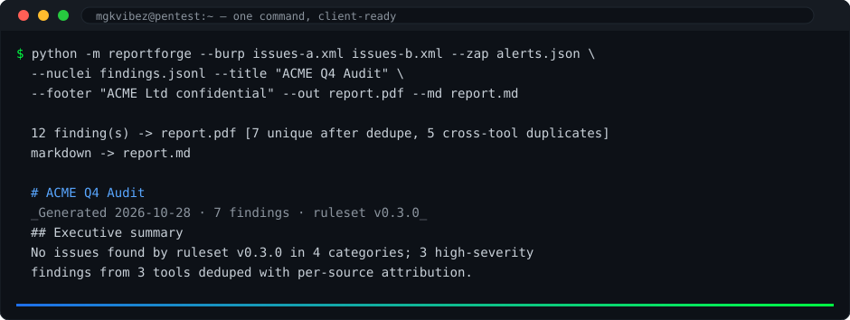

# reportforge

> Burp XML in. Client-ready PDF out.

**Status: v0.1.0 — Burp XML in, PDF + markdown reports out.** ZAP and nuclei parsers are next on the roadmap.

reportforge is a command-line pentest report generator:

- Parses Burp Suite XML, OWASP ZAP and nuclei JSON exports
- Findings are plain Markdown — easy to edit, easy to diff
- Renders a polished PDF: executive summary, severity matrix (CVSS-mapped),
  technical appendix, remediation advice from reusable finding templates
- Zero web app, zero hosting: `pipx install reportforge`

Built for pentesters who would rather hack than format documents.


<div align="center">
  
</div>

_Three scanners, one branded PDF: cross-tool findings dedupe with per-source attribution._

## Usage (planned)

    reportforge ./burp-export.xml -o report.pdf

## Quickstart

    python -m reportforge --burp sample-issues.xml --zap alerts.json --nuclei out.jsonl --out report.pdf --md report.md

15 offline tests: python -m unittest discover -s tests

## Documentation

- [docs/research.md](docs/research.md) — market research and competitive landscape
- [docs/roadmap.md](docs/roadmap.md) — development milestones toward v1.0.0


## v0.3 — multi-project merging and branding

`--burp a.xml b.xml` (and the same for `--zap`/`--nuclei`) merges many
scans and engagements into one report: duplicate findings collapse by
tool + title + endpoint with per-source attribution preserved, and
conflicting severities resolve to the max with a note. `--title`,
`--subtitle`, `--footer` and `--accent` brand both the PDF and the
markdown. Example:

```console
python -m reportforge --burp acme.xml globex.xml --zap weekly.json \
  --engagement "Q4 consolidated" --title "Q4 Assessment" \
  --footer "Confidential" --out consolidated.pdf --md consolidated.md
```

## License


PolyForm Noncommercial 1.0.0 — personal, educational and
noncommercial use only; commercial use, distribution or shipping
in marketed products is not permitted. See [LICENSE](LICENSE).
